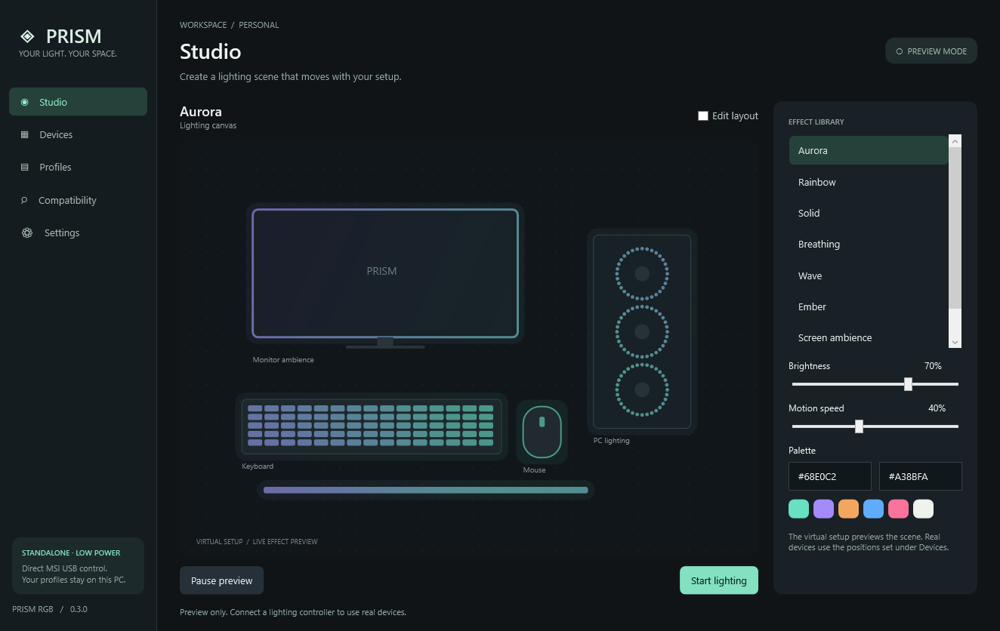

# Prism RGB

[](https://github.com/pyonpyonn/prism-rgb/actions/workflows/windows.yml)

A standalone Windows lighting app with **individual MSI ARGB LED control and Gigabyte RTX 4070 Ti lighting**. No OpenRGB, SignalRGB, SDK server, account, or background service is required. The portable x64 release bundles the .NET desktop runtime.

**0.8.0 alpha adds native boot animations from a saved Wave profile.** In Settings, preview the motherboard's two-colour wave and the GPU's custom Tricolor, choose a separate boot motion speed, then save to hardware once. The GPU omits black palette stops for boot. These firmware effects have their own timing and dark gaps; the full Prism profile resumes in Windows. Static boot colour saves remain available.



## Download and use

1. Download **PrismRGB-Windows-x64.zip** from [v0.8.0 Releases](https://github.com/pyonpyonn/prism-rgb/releases/tag/v0.8.0).
2. Extract the complete archive and open **Launch Prism RGB.cmd**. Use this new folder instead of an older extracted copy.
3. Exit other RGB controllers, including SignalRGB, MSI lighting tools, and RGB Fusion.
4. Choose **Devices → Connect lighting**. The app connects the motherboard and queries the supported GPU if available. Connecting does not start color output.
5. Choose an effect and brightness, then **Start lighting**.
6. **Stop & restore** clears streamed colors and restores the motherboard's configuration. Previous external per-LED animations and GPU colors cannot be recovered; GPU LEDs are cleared on Stop.

Manual first launches start with output off. Optional Windows startup can restore saved lighting after sign-in. For earlier static colors, use the one-time administrator setup in the [startup/boot lighting guide](docs/BOOT-LIGHTING.md#before-windows-sign-in). It creates a limited-rights task for the same user without storing a password; it does not reboot or change firmware. [Full usage](docs/USAGE.md).

## Supported hardware

| Hardware | Control |
| --- | --- |
| MSI B550M PRO-VDH WIFI (MS-7C95), USB 1462:7C95 | JRGB1/JRGB2 single colors; JRAINBOW1/JRAINBOW2 individually addressed chains, 1–120 configured LEDs each |
| Gigabyte RTX 4070 Ti Gaming OC, PCI 10DE:2782 / subsystem 1458:40C6 | Three fan lighting colors and a separate logo color, through the installed NVIDIA driver |

The motherboard's saved configuration supplied **60 LEDs per ARGB header** on the tested PC. That is a configured count, not physical LED detection. Counts and direction can be changed under Devices after stopping output. Lower-capacity chains use the visually confirmed compact stream. The 233–240 combined ARGB range uses a separate high-capacity path that has protocol tests but has not been visually confirmed on a physically populated chain of that size.

Other USB/catalog entries are research references and do not supply native drivers. The GPU adapter is restricted to the exact tested PCI identifiers. No extra kernel driver or NVIDIA DLL is bundled.

## Effects and individual colors

- Seven effects: Aurora, Rainbow, Solid, Breathing, Wave, Ember, Screen ambience.
- Separate 1–8 color palettes for every effect, including Rainbow and Ember; add/remove/reverse colors, eight presets, and restore original colors.
- Color spectrum and hue controls, hex/RGB input, quick swatches, and a screen eyedropper with magnification. Escape/right-click cancels screen picking.
- Global brightness, speed, draggable virtual preview, and local JSON scene profiles that retain every custom effect palette.
- Header LED counts, scene position/span, reverse direction, and numbered per-LED color overrides.
- Named **Fan 1 / Fan 2 / Fan 3 / Logo** GPU color overrides.
- Optional Windows sign-in startup, quiet tray launch, automatic saved-scene restore, single-instance activation, and retained last colors on Quit.
- Optional static boot lighting before sign-in, bounded device-readiness retries, and automatic handoff to the normal app.
- Explicit one-time static colour saves to the supported controllers' hardware memory, with separate motherboard/GPU results and no automatic persistent-write retries.
- Native boot motion from a saved Wave profile: temporary preview without a memory save, Slow/Balanced/Fast speed, MSI's first two profile colours and GPU Tricolor using up to three lit colours. The boot helper preserves saved native motion until Windows Prism starts.
- Read-only HID discovery and a descriptive compatibility catalog.

Expand **Choose colors for individual LEDs** under an ARGB header and click a numbered pixel. GPU controls use named lighting zones. **Return all LEDs to the effect** removes that output's overrides. Global brightness applies to manual colors too.

In **Studio → Effect colors**, select a numbered swatch and choose **Edit color** or **Eyedropper · pick from screen**. Picking freezes the displays temporarily and captures only to memory. After a click or cancellation, the images/windows are disposed and the picker thread ends. No ongoing screen capture runs for the eyedropper. Solid uses the first color; custom Screen ambience maps screen brightness through the palette. [Full color-editing guide](docs/USAGE.md#effect-colors-and-eyedropper).

## Smooth output with low ongoing resource use

Motherboard animation targets **up to 30 updates/second**, GPU lighting up to **15**, and preview rendering up to **8**. GPU I/O runs separately and coalesces pending colors so it cannot delay the motherboard stream. Unchanged controller packets are suppressed; Solid scenes sleep between changes. Hidden previews stop rendering. Screen ambience uses tiny 32x18 desktop samples only when needed, at most twice/second. The separate eyedropper captures full display images only for the active selection.

GPU generic/busy errors get at most two packet retries. Continued failures reopen and reidentify the same supported card after 1, 2, 5, 10, then 30 seconds between attempts. Recovery keeps only the newest colors, also handles Solid scenes, and cancels on Stop/Quit. GPU status changes appear in the footer/local log without repeated tray popups or clearing the motherboard. Unsupported commands and identity mismatches pause only the GPU until reconnect.

See [measured CPU/GPU results](docs/PERFORMANCE.md). These are observations on one PC, not a universal guarantee. Software-rendered WPF avoids requesting accelerated app rendering; Windows composition may still use the GPU.

## Build, verify, package

Use Windows, **.NET 10 SDK**, and PowerShell 7:

```powershell
dotnet run --project source/PrismRGB.csproj -c Release
./scripts/build.ps1
./scripts/verify.ps1
./scripts/package.ps1
```

The ZIP and SHA-256 checksum are written to `dist/`. Windows CI runs 55 core and 30 interface checks using fake hardware without physical lighting writes. Tests include explicit hardware-save packets, no automatic commit retries, partial failures, UI save ownership, boot snapshots/readiness retries, retained one-shot delivery, controller handoff/cancellation, transient GPU recovery, hidden startup, palettes/dialogs and native protocol/idle checks. Startup UI checks use fake registration and do not modify Windows startup. Boot setup scripts support `-WhatIf`. The C# app has no third-party NuGet dependency.

```powershell
./scripts/measure.ps1
# Optional: these scenarios drive both supported controllers, then clear/restore them.
./scripts/measure.ps1 -Scenarios hardware-animated,hardware-solid
```

## Status and documentation

This is independent software, not a reconstruction of the compiled SignalRGB application or full feature parity. No vendor executable, original plugin source, paid content, or artwork is included. Fan-speed control, monitoring, game/audio integrations, LCDs, general plugin execution, and other hardware adapters remain future work. Pre-Windows and powered-off lighting are not guaranteed by retaining a volatile frame.

- [Usage and troubleshooting](docs/USAGE.md)
- [Windows startup, retained colors, and BIOS limits](docs/BOOT-LIGHTING.md)
- [Performance](docs/PERFORMANCE.md)
- [Architecture](docs/ARCHITECTURE.md)
- [Inspection evidence and limits](docs/INSPECTION.md)
- [Changelog](CHANGELOG.md)

Original Prism source is [MIT licensed](LICENSE). Microsoft runtime notices are included. Product names belong to their owners. Research references: [REA](https://github.com/morluto/rea), [SignalRGB developer documentation](https://docs.signalrgb.com/developer/plugins/), [NVIDIA NVAPI](https://github.com/NVIDIA/nvapi). None of the research tools or vendor apps is required at runtime.
