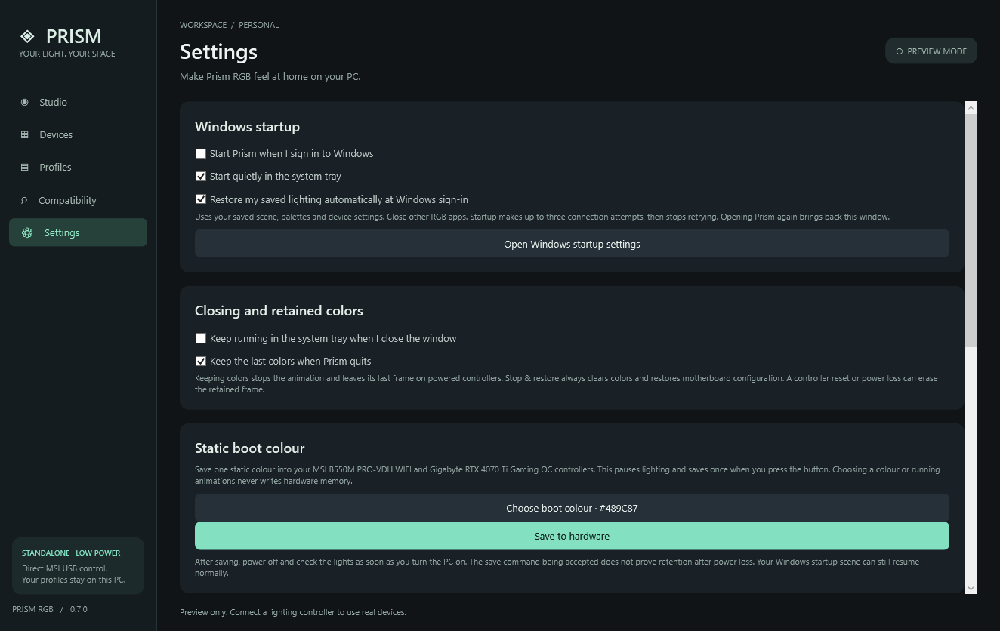

# Windows startup, closing, and boot lighting

Prism 0.9.0 can explicitly save a static colour or a supported native animation to controller memory. It can also apply a volatile frame before Windows sign-in once Task Scheduler and drivers are available, and resume the full Prism scene at sign-in. **Prism itself cannot run inside UEFI/BIOS or while Windows is shut down.** Lighting during those periods is controlled by saved hardware settings, firmware and power availability.

## Boot colour and effect preset library

Open **Settings → Boot lighting · continuous colours**. The library offers Lava, Ocean, Cyberpunk, Forest, Sunset and Ice fades, plus Lava steady. Each selection is an editable copy; changing it does not alter a built-in preset.

1. Choose a library preset, then choose **Continuous fade** or **Steady**. The library excludes the native wave and breathing modes that showed black gaps. Steady continuously uses colour 1.
2. Choose both colours using the colour pickers, `#RRGGBB` fields or screen eyedroppers. **Use my current Studio colours** copies the first two lit Studio colours into the boot draft; it does not alter Studio. Black and overly dark choices are rejected, including colours that become too dark at the selected brightness.
3. Set boot brightness from **10% to 100%**. For fades, choose **Slow**, **Balanced** or **Fast**. These hardware speed units differ from the Windows scene speed.
4. Give the palette a name and choose **Save preset to my library** to keep it on this PC. Up to 32 custom presets can be saved; saving an existing name replaces that custom preset. Choosing, editing or saving a library preset does not change controller memory.
5. Choose **Preview boot lighting · no hardware save** to inspect it. Prism pauses/drains its normal output, applies the native settings and disconnects without clearing them. The previously saved hardware setting remains stored. Reconnect under Devices to resume your normal Windows effect.
6. Choose **Save boot lighting to hardware** once to store the selection. MSI readback must match before one persistent save; the GPU receives its own single save command. Neither uncertain commit is retried automatically. This keeps your current Windows Studio scene and saved profiles unchanged.
7. When ready, shut down and power on; observe each device during the initial logo. Saving an effect still needs a physical power-cycle check. Windows Prism later resumes its existing scene after sign-in, including automatic sign-in.

Continuous fade uses the motherboard's tested native colour-transition mode and the GPU's matching custom-colour mode. Both receive the selected lit palette; the GPU receives an intermediate shade as well. No black stop is requested. The red/orange preview was accepted visually on the tested PC. Other library colours use the same modes, but every palette/device combination has not been physically verified.

The two controllers run their own clocks before Windows, so they can drift in colour timing. This is not a stored copy of Prism's renderer or a guarantee of exact phase synchronization. For a uniform synchronized fade while Windows runs, choose **Color fade** in Studio with two lit colours; Prism samples one shared scene time for all outputs. Boot preset edits do not select that Windows effect automatically.

After both hardware saves succeed, an existing boot snapshot records `PreserveHardwareWave` (the compatibility field name also covers fades and steady lighting). The Windows boot helper then exits without opening or writing either controller. Native lighting continues until the regular app takes over. The separate static-colour save below restores the earlier static-frame helper behaviour. Ordinary scene edits and startup never commit hardware memory.

## Save a static boot colour to hardware

1. Exit competing RGB software. In **Settings → Static boot colour**, choose a colour using the picker, hex/RGB input or eyedropper. The initial selection uses your current effect's first colour with current brightness; after saving a separate selection it remains independent of your effect palette.
2. Click **Save to hardware** once. Prism stops/drains its output, prepares native static modes for both supported controllers, checks MSI readback, and sends one persistent save command to each. Results are shown separately. Saving settings or starting effects does not perform a hardware save.
3. The static colour remains active with Prism output disconnected. Shut down normally when ready, then turn the PC on and observe the motherboard LEDs and GPU separately **during the initial BIOS/logo screen**, before Windows starts. Automatic Windows sign-in is fine. Windows Prism startup resumes your saved effect later.
4. To check retention through loss of mains power, shut down first, switch off the PSU/unplug only after shutdown, wait for standby LEDs to go out, then restore power and boot. This is a separate observation from an ordinary shutdown/restart.

"Hardware save command accepted" confirms the operating system accepted the transfer. It does not prove nonvolatile retention; only the physical power-cycle test can establish that. If a commit reports uncertain delivery, Prism does not retry it automatically. Check the observed colour before choosing to save again. MSI and GPU outcomes are independent, so one failure does not prevent the other attempt.

Only a single native static colour is stored for all supported motherboard headers/onboard zones and the GPU's three fans/logo. Custom Prism animations and per-LED patterns still require Windows. This changes the controller lighting profile, not motherboard BIOS settings or firmware code. The controller must receive power to light LEDs; memory cannot provide standby power. Routine frame writes and the optional Windows boot task never request persistent storage.

The protocol facts are documented by the original [MSI controller implementation](https://gitlab.com/CalcProgrammer1/OpenRGB/-/blob/master/Controllers/MSIMotherboardController/MSIMotherboard185Controller/MSIMotherboard185Controller.cpp) and [Gigabyte controller implementation](https://gitlab.com/CalcProgrammer1/OpenRGB/-/blob/master/Controllers/GigabyteRGBFusion2GPUController/GigabyteRGBFusion2GPUController.cpp). Prism constructs its own narrowly validated packets and does not bundle those GPL implementations or require OpenRGB.

## Before Windows sign-in

The optional boot helper reads a saved frame, applies it to the supported motherboard/GPU, releases the controllers without clearing them, and exits. It has no preview, desktop capture or continuing effect loop. It attempts the controllers independently with limited readiness retries. The normal app takes priority after sign-in; a shared per-user controller lock prevents concurrent writes from the two Windows sessions. GPU lighting still depends on its NVIDIA driver being available in the noninteractive session.

Keep the app in its permanent folder and choose/save your scene first. Open PowerShell **as administrator using the same Windows account that uses Prism**, then run from the extracted Prism folder:

```powershell
$sid = [Security.Principal.WindowsIdentity]::GetCurrent().User.Value
./scripts/install-boot-lighting.ps1 -PrismExe "$PWD/app/PrismRGB.exe" -UserSid $sid
```

Setup exports only the fixed color frame and registers `PrismRGB-BootLighting-<user SID>`. It uses an **At startup** trigger with zero added delay, normal process priority (task priority 5), and the same user's limited-rights **S4U** identity. Re-running setup upgrades the old five-second delay/background priority. No password is stored. It does not run as SYSTEM, start a background service, restart Windows or change BIOS/firmware. Microsoft requires administrator registration for [boot-trigger tasks](https://learn.microsoft.com/en-us/windows/win32/taskschd/boottrigger); [S4U tasks](https://learn.microsoft.com/en-us/windows/win32/api/taskschd/ne-taskschd-task_logon_type) run on a noninteractive desktop with local resources only. Do not use a different administrator account for setup.

The helper uses `%LOCALAPPDATA%\PrismRGB\boot\boot-frame.json` and writes `boot-result.json` there. The result records process-start and separate successful motherboard/GPU delivery times, so scheduler startup and driver readiness can be distinguished. Existing boot frames update automatically when Prism saves color/device changes. The boot frame samples an animated scene at a fixed point; it does not animate. Screen ambience uses a saved palette color instead of capturing the sign-in screen. Brightness, header lengths, enabled outputs and manual LED colors are retained.

Keep normal Windows sign-in startup and saved-lighting restore enabled if you want the animation to resume. Re-run setup with the new permanent executable path after moving the app. To remove only the boot task, leaving normal sign-in startup and settings intact:

```powershell
./scripts/remove-boot-lighting.ps1 -PrismExe "$PWD/app/PrismRGB.exe" -UserSid $sid
```

Use `-WhatIf` to review setup/removal without changes. Setup does not test the task or reboot the PC. Windows starts boot-trigger tasks when Task Scheduler starts; removing the added delay cannot move the helper ahead of Windows or driver initialization. Fast or automatic sign-in can still finish first. A noninteractive test can establish device access, but the next real boot is needed to verify timing on this PC. The helper has no continuing CPU work once its static frame is applied.

## Start with Windows



Interface example from isolated tests; the startup registration in this example is simulated.

Keep the complete app folder in its permanent location, then enable these options in **Settings → Windows startup**:

- **Start Prism when I sign in to Windows** registers this executable for the current user.
- **Start quietly in the system tray** avoids opening the main window.
- **Restore my saved lighting automatically at Windows sign-in** connects the supported controllers and starts the saved scene, palettes, brightness and device settings.

Prism waits two seconds before its first connection attempt, then allows retries after three and five seconds if the controller is unavailable. There are at most three attempts, with no permanent retry loop. Startup waits for the first motherboard frame to succeed before reporting success. Stop or Quit cancels pending startup. Competing RGB software blocks output; disable its automatic startup separately. A failure is reported in the tray and the local `startup.log` beside preferences. A missing GPU does not prevent available motherboard lighting.

Sign-in startup uses the current user's `Run` entry named `PrismRGB`, pointing to the quoted app path with `--startup`. This part needs no administrator account, service, BIOS change or scheduled task; the optional earlier boot helper above is separate. Windows **Settings → Apps → Startup** can also disable the Run entry. Re-enable it from the new copy if you move the portable app. [Microsoft's startup documentation](https://support.microsoft.com/en-us/windows/experience/startup-boot/configure-startup-applications-in-windows) describes sign-in startup and the registry location.

Only one normal instance runs in the current user/session. Launching Prism again opens the existing window; an extra automatic startup launch stays quiet. `PrismRGB.exe --quit` requests a graceful exit from that instance. Diagnostics use their own isolated instances.

## When you close the window or quit

**Keep running in the system tray when I close the window** hides the window while effects continue. Use the tray menu to open it, Stop, or Quit.

**Keep the last colors when Prism quits** freezes the most recently delivered frames instead of clearing them. Controller handles and the GPU worker are released. This retains colors only as long as the controller keeps its state and receives power. It does not continue the animation or save a hardware/BIOS profile. When Windows ends the session with this option enabled, Prism stops its timers and avoids sending a black frame; Windows performs process teardown.

**Stop & restore** always clears streamed colors and restores the original motherboard configuration, even when Keep colors is enabled. With Keep colors disabled, normal Quit does the same cleanup. Previous external pixel animations and GPU colors cannot be reconstructed.

All automatic lighting and retained-color options are opt-in. Startup/closing preferences are separate from exported scene profiles.

## During BIOS boot or while the PC is off

The MSI B550M PRO-VDH WIFI has a physical **LED_SW1** switch and BIOS RGB Light Control support. MSI says the switch must be on for motherboard lighting when BIOS RGB control is enabled. This enables hardware lighting; it does not store Prism's scenes or prove that JRAINBOW receives standby power. See [MSI's model-specific RGB control FAQ](https://www.msi.com/faq/3928) and [the motherboard manual](https://download.msi.com/archive/mnu_exe/mb/E7C95v1.7.pdf), LED_SW1 on page 41.

Whether the ARGB headers or GPU remain lit in shutdown depends on their power rails, controller reset behavior and firmware. A driver or controller reset can replace a retained frame. Removing power clears volatile state. The card cannot display colors if its lighting loses power. MSI's USB charging/ErP instructions do not establish ARGB-header or GPU standby-lighting support.

Routine Prism output keeps MSI's persistent-save flag disabled. The explicit hardware-save actions above use it once for the chosen native configuration; the GPU uses its separate save command. Neither action modifies BIOS settings, flashes firmware code or installs a pre-boot driver. **BIOS/cold-boot and powered-off lighting still require physical verification on each setup.**

## Check the behavior on your PC

1. Enable Windows startup, tray mode and automatic restore. Choose a scene and start lighting.
2. Enable Keep colors, then choose **Quit** from the tray. The animation should stop at the last colors while the controllers remain powered. This is different from Stop & restore, which clears them.
3. When you next choose to restart normally, check what the LEDs do during BIOS and after signing in. Prism should resume its scene after sign-in. Record any gap or hardware-default colors during boot.
4. If the boot task is installed, check for the static saved colors after Windows begins starting but before sign-in. Inspect `boot-result.json` for separate motherboard/GPU results; a skipped helper means normal Prism already held the controllers or requested handoff.

No restart, shutdown or BIOS alteration is performed by enabling these app settings. A real power-cycle observation is needed to establish what this hardware retains outside Windows.
