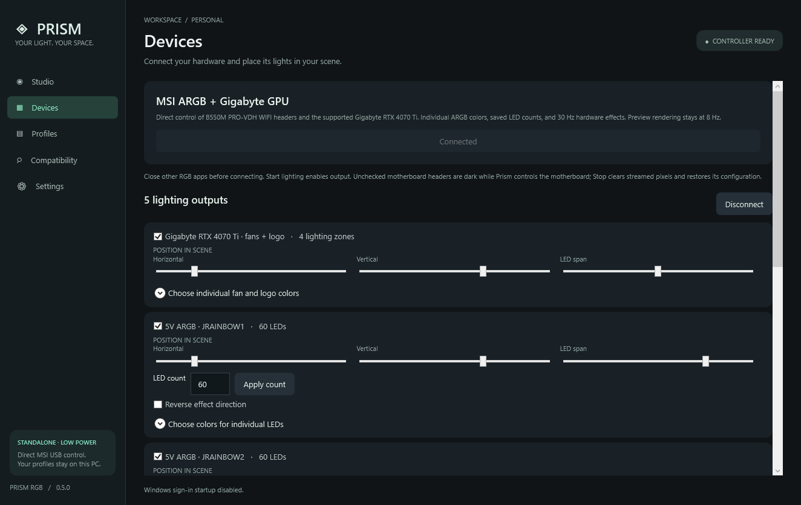
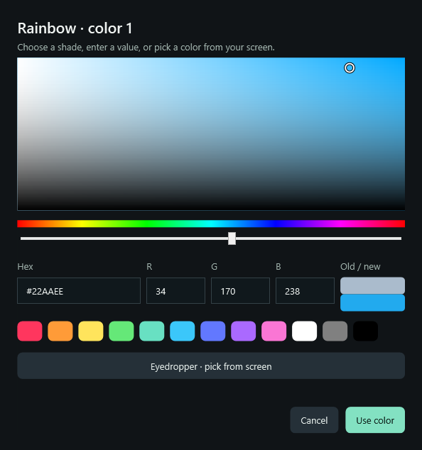

# Using Prism RGB 0.5.0

Extract the complete [v0.5.0 Windows x64 release](https://github.com/pyonpyonn/prism-rgb/releases/tag/v0.5.0) and open `Launch Prism RGB.cmd`. Use the new executable rather than an older extracted build. The .NET desktop runtime is bundled.

## Connect and start

Exit SignalRGB, MSI RGB tools, and RGB Fusion, then choose **Devices → Connect lighting**. This reads motherboard state and sends the supported GPU's identity query; it does not start color output. The footer reports whether GPU lighting is available. The motherboard remains usable if GPU detection fails.

Supported controllers are MSI B550M PRO-VDH WIFI (1462:7C95) and Gigabyte RTX 4070 Ti Gaming OC (10DE:2782, subsystem 1458:40C6). Other board/GPU identifiers are rejected. GPU access uses the installed NVIDIA driver API without a bundled kernel driver.

Choose an effect, palette, and brightness in **Studio**, then **Start lighting**. Unchecked motherboard headers receive black while Prism owns the motherboard controller; it needs a complete stream routing configuration. Stop before changing enabled headers or counts.

**Stop & restore** clears streamed ARGB/GPU colors and restores the saved motherboard configuration. It cannot recover an earlier app's per-LED animation or previous GPU colors. Disconnection or another controller taking ownership can prevent cleanup. Output stays off after a runtime failure. Manual first launches start with output off; Windows startup can resume it only when enabled explicitly.

## Individual ARGB LEDs



Interface example rendered with simulated devices during the UI checks.

Each JRAINBOW header has these controls under Devices:

| Control | Use |
| --- | --- |
| LED count / Apply count | Set 1–120 pixels on that chain, while output is stopped |
| Horizontal / Vertical | Position the chain in the scene |
| LED span | Distance across the scene covered by the chain |
| Reverse effect direction | Reverse scene sampling along the chain |
| Choose colors for individual LEDs | Expand and click a numbered pixel to set a manual color |
| Return all LEDs to the effect | Clear that output's manual colors |

Counts initially come from the controller's saved configuration: 60 on each tested header. This does not measure physical chain length. If you do not know the count, begin with the retained setting and adjust after identifying your fan/strip model. A parallel splitter mirrors its shared data signal; software cannot turn it into separate chains.

The combined 1–232 ARGB range uses the compact stream verified visually on the tested 60+60 setup. Larger combinations, up to 120+120, select the independently addressed high-capacity path. That path has protocol tests but no visual confirmation on a physically populated 240-pixel setup.

## GPU lighting

The GPU output exposes **Fan 1, Fan 2, Fan 3, Logo**. Expand **Choose individual fan and logo colors** to set overrides; otherwise each zone samples the current effect. These are four lighting zones on the tested card, not individually addressable LEDs within every fan ring. Fan speed is never modified. Stop clears GPU lighting because the original state is not readable as a complete scene.

## Effect colors and eyedropper

Select any effect in **Studio**, then use **Effect colors**:

1. Select a numbered color swatch. **+** adds a color, up to eight. **Remove color** keeps at least one.
2. **Edit color** opens the saturation/value area, hue slider, quick swatches, and exact hex/RGB fields. Hex accepts six digits with or without `#`; RGB values are 0–255. **Use color** applies; **Cancel** keeps the existing color. The color area also supports arrow keys and Shift for larger steps.
3. **Eyedropper · pick from screen** lets you click a pixel on any connected display. A magnifier and hex value show the selected pixel. **Escape** or **right-click** cancels. The editor's eyedropper temporarily makes the dialog transparent, then returns to it for confirmation.
4. **Color presets** offers Mint & lilac, Ocean, Sunset, Cherry blossom, Fire, Ice, Monochrome, and Full spectrum. **Reverse colors** reverses their order.
5. **Restore original colors** resets only the current effect. Switching effects retains the other effects' edits. Save a profile to keep/export all custom effect palettes.



| Effect | Custom palette behavior |
| --- | --- |
| Aurora | Blends across every stop with the original motion |
| Rainbow | Cycles smoothly through the chosen stops, including the last-to-first transition |
| Solid | Uses the first stop; remove extra stops for a single-color palette |
| Breathing | Cycles the colors while fading in and out |
| Wave | Waves through the chosen gradient |
| Ember | Keeps the flicker pattern with your colors instead of fixed orange/red |
| Screen ambience | Maps desktop luminance through the palette and follows screen brightness; black stays black |

Without edits, the original effect colors/behavior remain available, including full-spectrum Rainbow, warm Ember, and direct screen color. Brightness applies to every effect and manual override. Manual colors set under Devices remain fixed until cleared.

The eyedropper takes one frozen image per display, retains them only in memory, and releases images, overlays and its temporary thread after selection/cancellation. It does not save screenshots or continue polling. Physical screen coordinates are used for pixel selection; negative monitor origins have automated coverage. Actual mixed-DPI/multiple-monitor and HDR color fidelity have not been verified on every configuration. Protected content may not be capturable.

## Profiles and preview

Hardware animation is capped at approximately 30 updates/second for the motherboard and 15 for GPU lighting. Preview rendering is capped at 8 and stops while hidden/minimized or on other pages. **Pause preview** freezes only the illustration; hardware continues. Screen ambience samples at most twice/second and does not map screen regions or multiple monitors. Samples remain in memory.

The draggable virtual setup is illustrative. Real outputs use the Devices position/span controls. **Profiles** saves the selected effect, all custom effect palettes, brightness, speed, and virtual layout. Existing profiles without custom palettes still load with their original colors. Device counts, direction, enabled outputs, placements, and individual overrides are separate local preferences, not exported scene profiles. Applying another profile leaves manual overrides active until cleared.

Profiles can be saved, replaced by name, deleted, and imported/exported as Prism JSON up to 1 MiB. Preferences live at `%LOCALAPPDATA%\PrismRGB\settings.json`; **Settings → Open profile folder** opens it. Quit before backing up/resetting settings. Old settings are migrated to use saved controller counts and a usable span when first enabling per-LED control.

## Startup, closing, and boot lighting

Under **Settings → Windows startup**, enable **Start Prism when I sign in to Windows**, **Start quietly in the system tray**, and **Restore my saved lighting automatically at Windows sign-in**. Use a permanent app folder. Close/disable competing RGB startup apps. Connection attempts are limited to three; Stop/Quit cancels pending startup. Launching Prism again opens the existing instance.

Default Close clears/restores and quits. **Keep running in the system tray when I close the window** keeps effects running. **Keep the last colors when Prism quits** stops animation and leaves the last delivered frame while the controller remains powered, including best-effort Windows-session shutdown preparation. Stop & restore always clears/restores. `PrismRGB.exe --quit` also requests a graceful exit.

Prism cannot run in BIOS or while the PC is off. Last-frame retention is volatile and does not establish cold-boot/shutdown lighting support. See the [boot lighting guide](BOOT-LIGHTING.md) for verified MSI controls, power/reset limitations, and a manual restart check. No BIOS settings or controller flash are changed. No installer or auto-updater is included.

## Troubleshooting

| Problem | Check |
| --- | --- |
| 0.2.0 connects but produces no visible ARGB colors | Use 0.4.0 or later; the old color-field-only path did not supply the required stream/routing. |
| Connection blocked | Close competing RGB tools and verify the exact supported hardware. |
| GPU unavailable | Check the footer, installed NVIDIA driver, exact card identifiers, and competing RGB apps. Motherboard output can still be used. |
| Some LEDs stay dark or patterns repeat | Check the configured count, chain wiring/splitters, brightness, and manual overrides. |
| Profile changes leave some colors fixed | Clear that output's per-LED overrides. |
| GPU fans/logo do not match | Use the named GPU controls; motherboard headers do not control the card directly. |
| Screen ambience is black | Protected content or an unavailable desktop can prevent sampling; try another effect. |
| Stop cannot restore everything | The previous external pixel scene is not recoverable. Another app or disconnection can prevent configuration cleanup. |
| Another USB device appears but cannot be controlled | It needs a future native adapter. The Compatibility catalog is descriptive research metadata. |

## Diagnostics

With competing RGB software closed, these explicit tests change supported hardware briefly and clear/restore it afterward:

```powershell
./dist/app/PrismRGB.exe --test-argb argb-test.json
./dist/app/PrismRGB.exe --test-gpu gpu-test.json
```

The ARGB test lasts about 40 seconds and shows red/green/blue followed by distinct moving pixel colors. The GPU test lasts about 15 seconds and shows red/green/blue. API success is reported separately from visible confirmation, which requires someone observing the lights.

`--inspect-msi <result.json>` only reads descriptors/current configuration. `--self-test` uses fake controllers and read-only HID enumeration. `--ui-smoke <folder>` exercises interface/color controls and synthetic eyedropper images with fake devices; `--render-preview <png>` renders the illustration. `--verify-eyedropper <result.json>` briefly displays a known color target and verifies actual screen capture plus synthetic selection/cancellation, without lighting writes. Use `--data-dir <folder>` for isolated diagnostic preferences. Build/test/package scripts and [performance measurement](PERFORMANCE.md) are documented in the root README.
